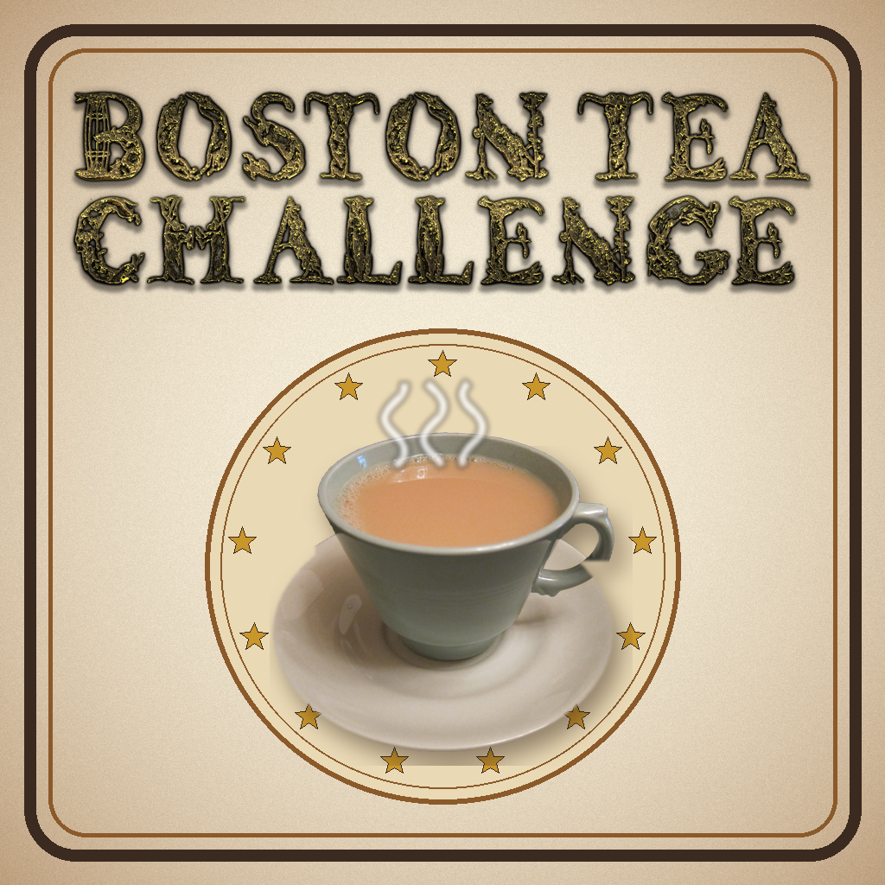

# Boston Tea Challenge

A turn-based tea-drinking rhythm game. It's 1783, the Revolutionary War is won, and the Founding Fathers (plus some presidents from the future) celebrate with a tea-drinking contest.

**▶ Play in the browser:** https://joshuamrumack-collab.github.io/bostonteachallenge/

## How to play
- Pick your character, a CPU opponent, a stage and a match length.
- On your turn choose **Drink** (1), **Chug** (2) or your character's **Special** (3).
- Press the letter on each circle (or click the lane) as it lands in the ring. Better timing = more tea.
- Most tea when the clock hits zero wins. Wins earn dollars to unlock more characters and stages.

Afterwards, the "What Did You Learn?" box covers the Boston Tea Party, the Founding Fathers and the Treaty of Paris (1783).

A DorkTeach classroom game.
